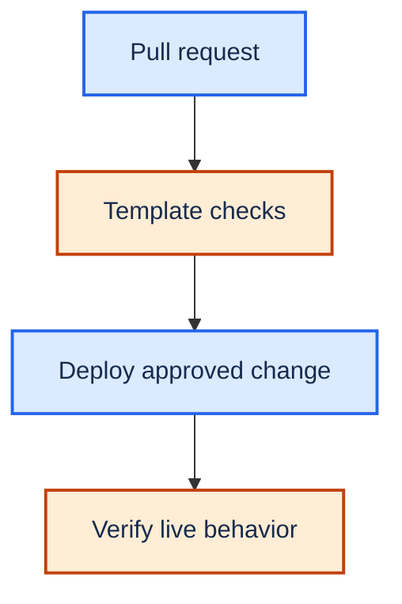
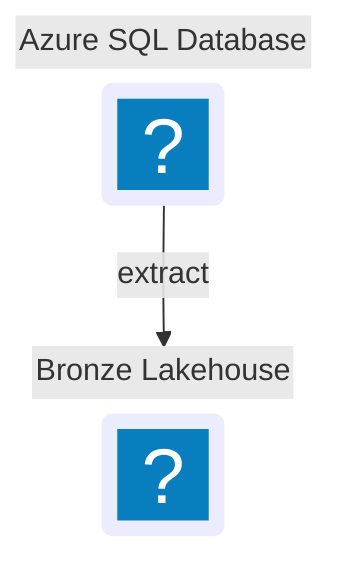

# Mermaid diagrams for Acestus

Put diagrams in fenced `mermaid` blocks in the owning Markdown file under `site/content/articles/` or `site/content/docs/`. The site layout and `web/shell/docs.js` render these blocks with the Pele version pinned in `package.json` and preserve a readable source fallback. Keep the Markdown as the source of truth.

- Use `flowchart TD` for pipelines, branching decisions, and operational workflows. Use `sequenceDiagram` for message exchanges, `stateDiagram-v2` for state transitions, and `mindmap` for related ideas without an implied order. Keep a compact horizontal diagram when it serves a comparison or waterfall.
- Keep node names short, edge labels specific, and branch conditions visible. Add a descriptive `accTitle` to flowcharts. Describe the core result in the adjacent prose so meaning does not depend on the diagram or its colors.
- Use two complementary hues for topic flowcharts, with pale fills, dark text, and a 2 px colored border. Group nodes by their function, such as implementation versus verification. Choose distinct pairings across neighboring guides. Reserve Bronze, Silver, and Gold colors for actual medallion layers.
- Use Azure or Fabric service SVGs through the local icon registry for real services. Do not use emoji as diagram icons. For concepts without an appropriate service icon, use plain text nodes. Keep service names in labels. Use the existing Pele CSS theme for sequence diagrams and general typography. Check the pinned Pele renderer before relying on Mermaid extensions, icons, or initialization directives.

## Service icons

Use named icon nodes when a flowchart names an Azure or Fabric service:

Use the names registered in `web/shell/diagram-icons.js`. Its resolver bundles local SVGs so published diagrams can render independently of external icon servers. Add icons from the [Microsoft Azure](https://learn.microsoft.com/en-us/azure/architecture/icons/) and [Microsoft Fabric](https://learn.microsoft.com/en-us/fabric/fundamentals/icons) collections when needed. Preserve product icon artwork and colors. Apply diagram palette colors to boxes and arrows. Use familiar pictograms for everyday concepts without a product icon.

## Medallion flows

Use source and consumer blue (`#E8F0FE`, stroke `#1A73C7`), Bronze wheat (`#F5DEB3`, stroke `#CD7F32`), Silver gray (`#E8E8E8`, stroke `#808080`), and Gold cornsilk (`#FFF8DC`, stroke `#DAA520`). Set inbound arrow colors with `linkStyle` using zero-based edge indices. Review the indices after reordering edges.

## Cost and savings diagrams

Use a labeled hierarchy for spend drivers and savings priorities, then a compact flow or waterfall for the total change. Keep critical spend red, high spend orange, moderate spend yellow, network resources blue, fixed spend slate, and savings green. Include amounts, units, and time periods in labels. Validate the figures against the article.

## Review

Build the site and check the article in its published layout. Confirm the diagram renders in Pele, its labels fit a narrow viewport, and the Mermaid source remains available. Check the renderer's error output as well as whether it produced an SVG.
