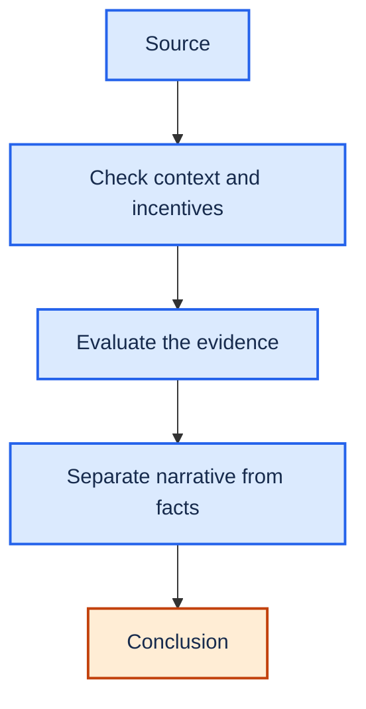

That’s an interesting question. I’m a trained historian, and one of the hardest things I studied was hermeneutics: understanding a source, determining whether it is primary or secondary, identifying its inherent biases, and using it to develop a conclusion. It requires a great deal of critical thinking, and it is some of the hardest knowledge work I have done.

It is even harder now because we are surrounded by so much information. It can be difficult to determine what to trust and to sift through competing claims. In a practical sense, I treat this as an information problem. I have to evaluate data and use simple hermeneutic principles even when reading technical documents and blog posts from people I know.

I created a curated RSS feed largely to manage this difficult problem. If I turn on the television and listen to whoever appears, I may not know who they are, what they are trying to promote, or what incentives are shaping their message. I don’t have enough context to decide whether I should believe or reject what they are saying. That is a genuinely difficult problem.

A wrestling production openly tells its audience, “Here is the good guy, here is the bad guy, here is the story—have a good time.” Much of modern information works the same way, but the audience is not allowed behind the curtain. It can be difficult to distinguish the narrative from the underlying facts.

For now, a highly curated RSS feed is my refuge. Evaluating sources, understanding their context, and deciding which conclusions are justified remains some of the most challenging work I do. That habit is useful in technical work, where the first explanation is not always the whole explanation.

## Supporting visual (not spoken)

