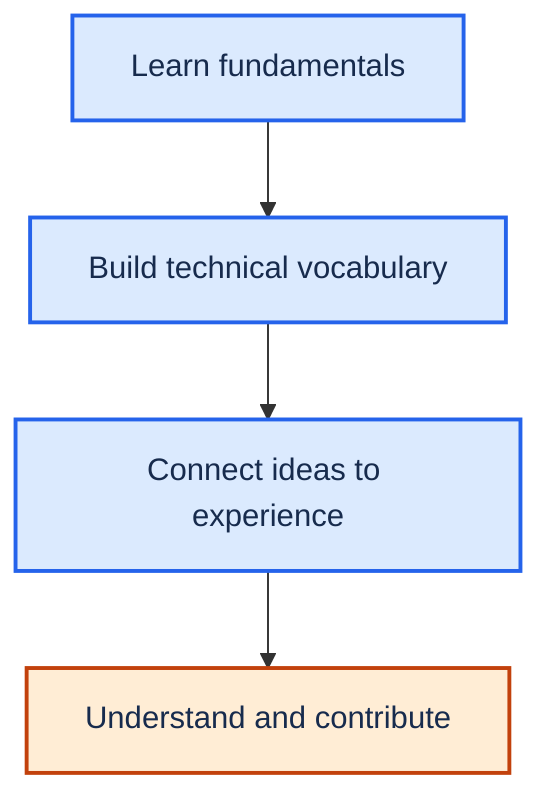

One thing I am particularly proud of is learning to understand computer science and software engineering more deeply.

I love Linux and have worked as a Linux administrator. I was even hired by Microsoft because of my Linux knowledge. I had spent years doing contract work, which paid the bills, but I wanted stable work where I could develop more fully as an engineer.

At times, I felt as if I had to work through my own ignorance and fundamentally rewire my thinking. I had to learn how computers represent and process information, along with concepts such as data structures and algorithms. It took time, but I eventually reached the point where I could understand Hacker News and follow what engineers were discussing.

I was proud when I could read an article or watch a technical talk and understand terms such as Git versioning, idempotency, resilience, immutability, and the shared vocabulary of the field. These terms sometimes function as shibboleths, indicating that someone belongs to a particular technical community.

Learning that vocabulary opened a new world to me. I could listen to highly technical talks, read technical documentation, and understand how a new idea fit into an existing mental model. I could decide where to place the information and how it related to systems I had already encountered.

Knowledge is power, and I’m proud of having worked hard enough to participate in conversations with some of the smartest engineers in the world. That accomplishment also reflects who I am as an “information person”: I love taking in complex material, organizing it, and figuring out how the pieces connect.

## Supporting visual

## Video walkthrough


