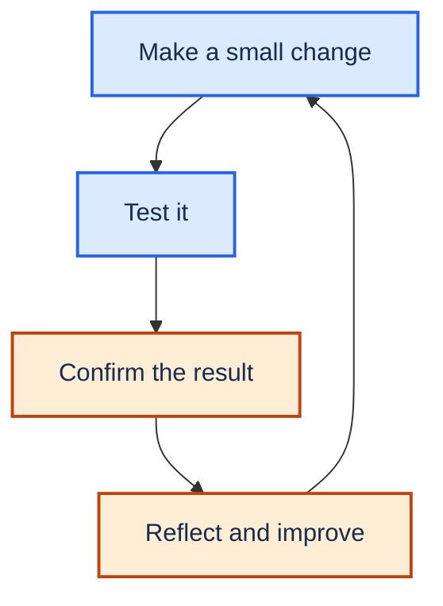

I’m happiest when I am working in a way that resembles the kind of work described in *The Phoenix Project*.

I’m a DevOps enthusiast. I believe productive engineering requires balance—perhaps 50 percent project work and 50 percent research, improvement, and reflection. If all of your time is spent doing the work, you never get the opportunity to step back and confirm that you are moving in the right direction.

Rest and reflection are necessary. They provide a chance to examine your decisions, be self-critical, and ask whether the work should be done differently. The most difficult questions are often not “How do we do this?” but “What should we be doing?”

I’m happiest when my actions match what I believe I should be doing most of the time. In more concrete terms, I love the practices associated with continuous integration and continuous delivery. I enjoy making a small change, creating or running a test, confirming the result, and then moving forward with evidence. That feedback loop is deeply satisfying to me.

That is the kind of work I want to bring to a client engagement: make progress in manageable steps, learn from the result, and leave room to improve the way the work is done.

## Supporting visual

## Video walkthrough

[Watch the The work that makes me happiest video](/videos/happiest-at-work/).
