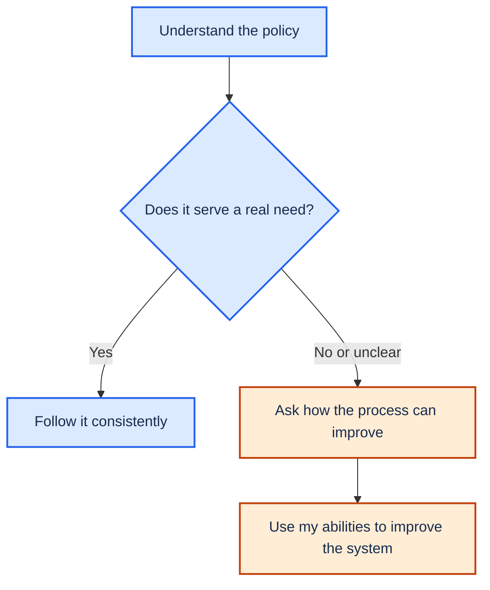

I’m unhappiest when I’m not meeting my potential.

There was a time when much of my work consisted of resetting passwords. I knew I could contribute much more, but I was stuck in a box defined by procedures and policies. Policies matter, and I understand the need for a company to move in one direction rather than have everyone acting independently.

Still, there is a difference between following a necessary process and continuing a process simply because it is written down. The military often operates that way because regulations require it. I have encountered similar situations in technology, where I knew a task might not be optimal or even worthwhile, but I was expected to do it anyway. That makes me unhappy.

I should also give a more personal answer. I have had to work on 16 Sundays during my career. I have three sons and three daughters, and spending a Sunday away from them is a real cost. I already have fewer Sundays with them than I would like, and I have had to give 16 of those days to my employers.

So my answer has two parts. Professionally, I’m unhappy when I am prevented from using my abilities to improve systems. Personally, I’m unhappy when the sacrifice of time does not produce work meaningful enough to justify being away from my family.

That is part of why I value clear priorities and meaningful work in a contract engagement. I want to use my abilities to help improve the systems and processes a client depends on.

## Supporting visual

## Video walkthrough


