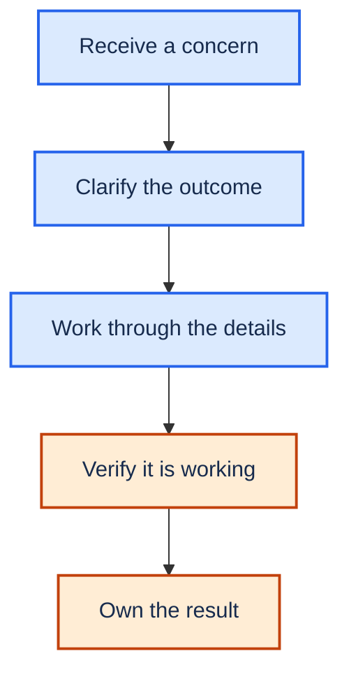

One concept I find useful is the distinction between a “barrel” and “ammo.” An organization needs both. An intern can be a barrel, by the way—it is not a title or a level of seniority.

I associate being a barrel with responsibility, curiosity, teamwork, and versatility. Ammo might be a clearly defined ticket: receive the task, complete it, and provide the requested result. A barrel is someone who can be given a stack of concerns and trusted to work through them.

Suppose a company needs an important delivery completed on a deadline. People are working late, everyone is hungry, and someone needs a smoothie delivered cold and on time at 7 p.m. If the usual option is closed or the order is late, a barrel still finds a way to make it happen. The person confirms the details, follows through, and takes ownership of the result.

I have tried to cultivate that quality in myself. If a business has a stack of concerns, I’m willing to take ownership of several of them. Give me the problems, and I will work until they are resolved. I still welcome oversight, supervision, and review, but I want to own the process and the outcome.

That is especially relevant to the software development lifecycle and infrastructure operations. I can own the infrastructure, CI/CD pipeline, and delivery process, verify that it is working, and make sure the work is completed. That is what responsibility looks like in my day-to-day work.

## Supporting visual

## Video walkthrough


