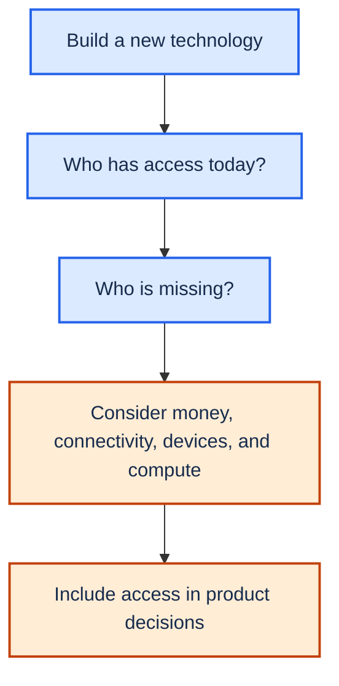

I think empathy is often violated as organizations adopt artificial intelligence.

In some sense, this is not a new failure. Companies tend to optimize for the customers, employees, and shareholders with whom they already interact most closely. But AI makes the imbalance more visible. The United States has data center after data center, and many users can purchase large token allocations and use powerful devices. People in countries such as Guatemala may not have the same access.

If a person owns an iPhone, they are already in a privileged group globally. Many technology discussions nevertheless assume that this level of access is normal. What about everyone else? What about people who do not have the money, connectivity, devices, or compute resources to participate in the systems we are building?

I have not often seen enough empathy for that problem in the organizations where I have worked. Part of that is the incentive structure: public companies are expected to increase shareholder value, and that priority shapes decisions.

Capitalism has a remarkable ability to give self-interested people an incentive to produce valuable goods and services for others. I do not want to pretend otherwise. But there are cracks in that system, and one of those cracks is that the people with the least access often receive the least consideration.

For me, empathy means asking who can use what we build, who cannot, and what assumptions we are making about access. Those are questions worth bringing into technical and product decisions early.

## Supporting visual (not spoken)

