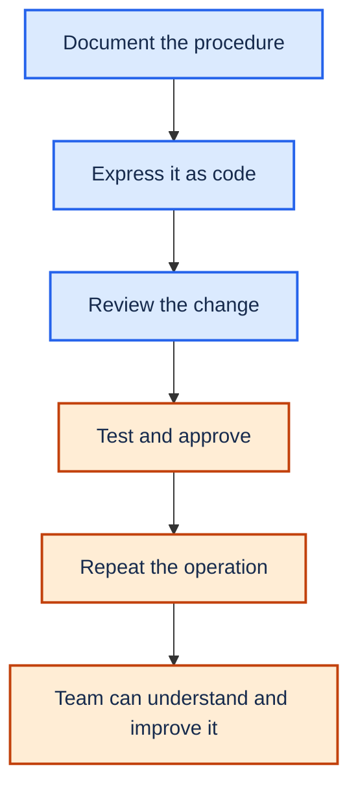

A tension I have encountered repeatedly involves curiosity and transparency.

Many people are comfortable with “click-ops.” They click through a web interface, make a configuration change, and move on. The process may work, but it remains opaque and depends on individual memory. Later, someone else may be unable to see exactly what changed, why it changed, or how to reproduce it.

With infrastructure as code and CI/CD, we can take runbooks, procedures, and operational knowledge and express them in reviewable scripts and configuration. Another engineer can examine the repository, understand the system, propose a change through a pull request, and let automated tests and approval gates verify it.

The difficult part is not simply telling people that this process is better. Moving from familiar interfaces to code requires them to become curious enough to inspect text, scripts, and tests. It can feel less convenient at first, even though it produces much greater transparency.

I have spent a substantial part of my career helping organizations work through that transition while migrating systems into the cloud. I’m interested in on-premises systems for the same reason: if a principle is sound, it should not depend on a provider. The Unix and cloud-native ideas behind automation, reproducibility, observability, and version control remain useful on-premises.

In these situations, I resolve the tension by making the process visible without demanding that everyone understand everything immediately. I write down the existing procedures, turn them into code, make changes reviewable, and build a repeatable path that others can learn. That respects curiosity without using it as an excuse for opacity.

The goal is not merely to replace clicking with text. The goal is to make the operation understandable, repeatable, and available to the entire team rather than hidden inside a few people’s accounts or memories.

## Supporting visual

