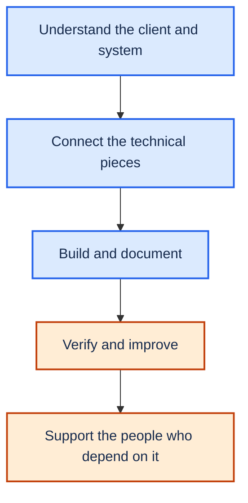

I’m a fan of the kind of engineering that makes complex infrastructure more understandable and dependable. I believe in building real systems correctly. At the end of the day, you can walk over to a rack and say, “I helped build that.” That is more tangible than an abstract resource in a cloud console.

I like working with people who take difficult technical problems seriously and are willing to work at the edge of what is possible.

I also like understanding where organizations came from and why they chose to do things differently. I would be proud to take part in work that changes how people think about computing and infrastructure. To a historian, that is an especially meaningful opportunity.

For a client, the practical version is this: I bring experience in Linux, infrastructure as code, automation, cloud migration, data engineering, and support. I can help build, operate, document, and improve systems, while helping the people involved understand how the pieces connect.

I enjoy taking in complex material, organizing it, and figuring out how the pieces connect. I want to make progress in a way that is visible and repeatable, and I welcome oversight, supervision, and review. I’m interested in meaningful technical work where I can contribute, keep learning, and help the system work better for the people who depend on it.

## Supporting visual

## Video walkthrough


