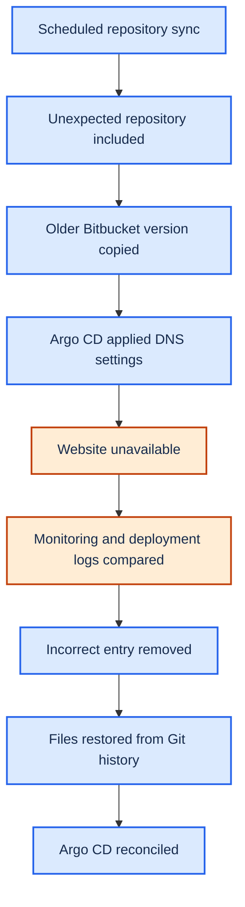

One incident I was involved in happened during a migration from Bitbucket to GitHub.

The migration had been approved by the executive team. I set up a GitHub Actions workflow that connected to the Bitbucket repositories over SSH, copied them into GitHub, and migrated 45 repositories. I then scheduled a cron job to run at 09:17 UTC each day so the repositories would remain synchronized during the migration.

The next morning, I found that a website had gone down at approximately 3:24 a.m. I used our monitoring logs to confirm the time of the outage, then examined the Azure Kubernetes Service cluster and its Argo CD logs. Argo CD had detected a Git commit and deployed it to the nodes at 3:24 a.m., matching the time the website became unavailable.

The migration workflow and offending scripts were in a GitHub repository. I reviewed the configuration containing the list of 45 source repositories and found a 46th repository with a name very similar to one of the intended repositories. That extra repository had not caused a problem previously, but in this migration the source of truth was the newer version in GitHub.

Because of that configuration error, I overwrote the GitHub repository with an older version from Bitbucket. The older version contained different DNS configuration. Argo CD deployed those settings, and the website went down. As the saying goes, “It’s always DNS.”

I removed the incorrect repository from the configuration with a pull request so that the workflow would not repeat the mistake. GitHub made it possible to restore the required files and DNS settings from the repository’s existing Git history. I restored the files to their previous state, pushed the correction, and Argo CD reconciled the deployment. The website came back online within a few minutes.

I had scheduled the migration job for 09:17 UTC in part because that would give me a recognizable timeline when investigating a large migration. When a system misbehaves, I start with the observed time, follow the evidence across systems, and check whether the change explains the symptom.

## Supporting visual

## Video walkthrough

[Watch the Analysis sample: Investigating a GitHub sync outage video](/videos/analysis-sample/).
