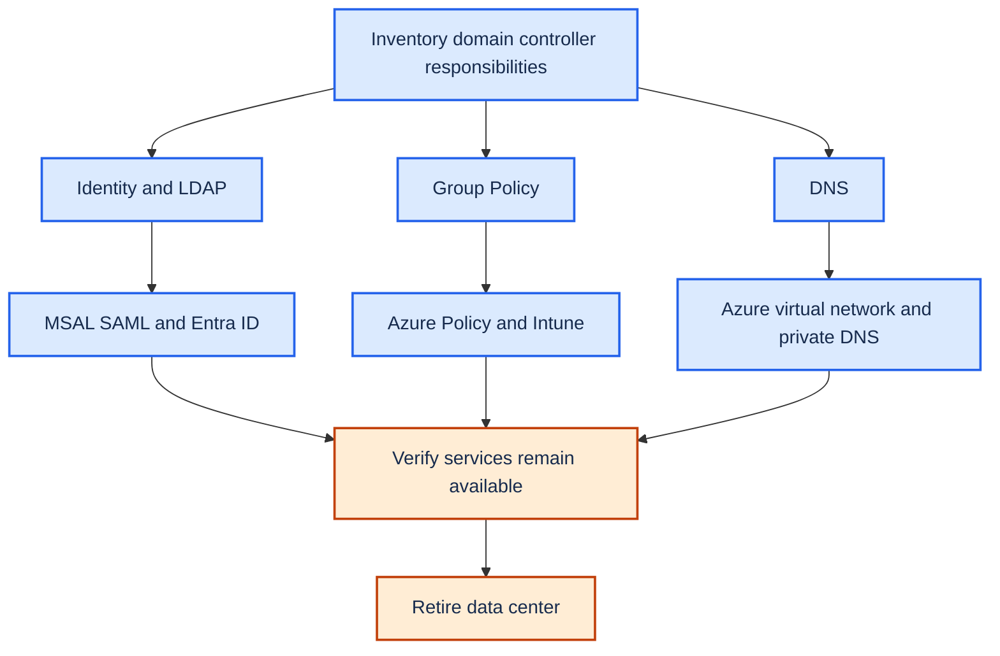

One support engagement involved helping a customer move out of its data center and into Azure.

The customer needed to retire its on-premises environment, including its domain controllers, which supported several important services. Domain controllers are complicated because they provide more than one function. They handled identity, LDAP bindings, Group Policy, DNS, and other dependencies.

I worked through those responsibilities one at a time. I helped move application authentication from LDAP and legacy integrations to MSAL, SAML, and Microsoft Entra ID. I replaced Group Policy with Azure Policy and Intune configuration management where appropriate. I also set up a virtual network and private DNS zone in Azure and moved the customer’s DNS responsibilities into Azure.

I was not the only person involved. Only one other person at the company had sufficient Azure access, and he helped me carry out the work. He understood the existing on-premises technology, while I was brought in because of my knowledge of Azure and Microsoft cloud technologies. I developed the plan and direction, and we worked through the migration together.

After approximately six months, the customer was able to shut down its data center and domain controllers. The services remained available, and the business continued operating normally.

For me, troubleshooting a complicated environment starts with understanding what the system is responsible for. A domain controller can look like one thing on a diagram, but it may be carrying several separate dependencies. I try to identify them, handle them one at a time, and make sure each responsibility has a place to go before retiring the old system.

## Supporting visual

