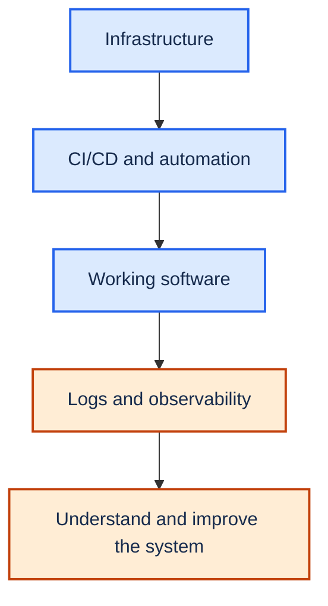

The ultimate measure of an engineer is their work. Here are a few examples that are representative of the work I like to do.

My website is [Acestus](https://acestus.com/). It brings together my technical work, writing, and portfolio.

I made a [video showing CI/CD with infrastructure as code](https://acestus.com/videos/cicd-with-iac/). I enjoy making a small change, creating or running a test, confirming the result, and then moving forward with evidence. That feedback loop is deeply satisfying to me.



I also wrote about [how I like to do logs and observability](https://acestus.com/logs.html). For me, logs are useful when they help someone understand what a system is doing and give them a way to investigate when something goes wrong.

And here is my [portfolio](https://acestus.com/portfolio/). I love taking in complex material, organizing it, and figuring out how the pieces connect. These examples show some of the ways I put that into practice: infrastructure, delivery, observability, and working software.

## Supporting visual

## Video walkthrough


