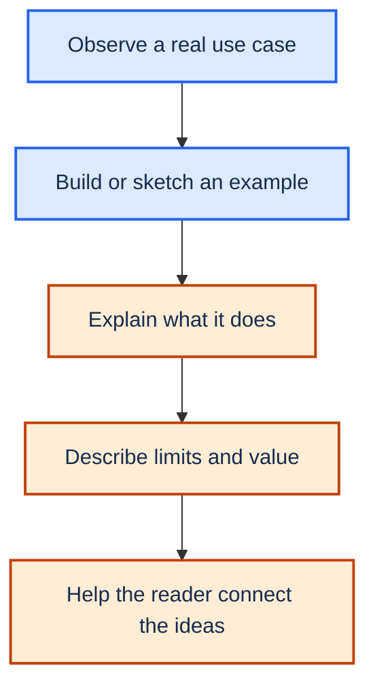

I value the written word. I like taking in complex material, organizing it, and figuring out how the pieces connect. Here are two writing samples that show different sides of that work.

In [my OpenClaw field report](https://acestus.com/articles/june-openclaw-field-report/), I wrote about two practical local AI agent setups: a Raspberry Pi business agent and a Mac mini personal assistant with private iMessage routing. I wanted to explain what I had built, what it could do, and where the limits were. I am interested in systems that live inside real workflows, not just a flashy demo.

In [my homeschool dashboard business idea](https://acestus.com/articles/homeschool-dashboard-business-idea/), I sketched a practical dashboard around curriculum progress, living-books lists, and reading progress. The interesting part is not just the homeschool niche. It is the pattern: take a real family workflow, turn it into a focused demo, and use that demo to test whether the workflow has enough value to become a product.

Those pieces are different in subject, but they reflect a similar approach. Start with a real use case, explain the details clearly, and make the connections visible. I try to write in a way that lets another person understand what I was thinking and decide what they can take from it.

## Supporting visual

## Video walkthrough


