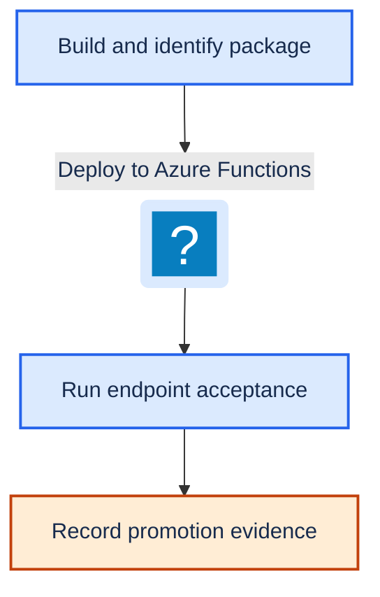

A successful package upload tells us that a delivery operation completed. An API release also needs evidence that the application started, its required dependencies are available, and a meaningful request works. The Acestus pattern makes those checks visible and binds them to the exact package being promoted.

This article presents a reusable design for a Python API on Azure Functions, using sanitized examples rather than details from a live application.

## Keep the hosting adapter small

Let the ASGI framework own routes, validation, dependency injection, and business logic. The Functions entry point should adapt the host to that application:

```python
import azure.functions as func
from app.main import app as fastapi_app

app = func.AsgiFunctionApp(
    app=fastapi_app,
    http_auth_level=func.AuthLevel.FUNCTION,
)
```

The authorization level in this example is a configuration choice to review against the actual ingress design. Network reachability and request authentication are separate requirements. A private runner still needs an approved way to authenticate; making a route anonymous does not solve private network access.

Keep three contracts distinct:

| Check | Question it answers |
| --- | --- |
| Liveness | Is the process responding on the expected route? |
| Readiness | Are the dependencies named by this contract available? |
| Business acceptance | Does a small synthetic request return meaningful results? |

Use fictional inputs and validate response fields. Production customer records do not belong in acceptance payloads or workflow logs.

## Build once and preserve identity

Pull requests should run focused unit, contract, and packaging checks without deployment credentials. A trusted trunk publication then builds and retains the deployable package with its provenance.

Keep these fields together:

```text
source commit
package SHA-256
producer workflow run ID
producer attempt
workflow revision
```

Promote the same package bytes to later environments. Rebuilding at each stage introduces another variable between the tested release and the deployed application.

Deterministic packaging is a useful build goal; hash verification establishes whether a selected retained package is unchanged. If dependencies are assembled during deployment, document that behavior and the resulting limits on the claim that every environment runs identical bytes.

## Make infrastructure reconciliation explicit

Application publication and infrastructure deployment have different effects. Declare the Function App, hosting plan, storage, monitoring, and required access configuration in Bicep. Reconcile reviewed infrastructure changes before publishing the package, and block publication if reconciliation fails.

A manual code publication should not quietly imply infrastructure deployment. The README and workflow inputs should tell an operator which operation they are starting.

Separate identities by purpose. The deployment identity manages the selected environment's resources and publication. The runtime managed identity accesses only the dependencies the application needs. An acceptance identity, where required, authenticates synthetic checks. Reusing one powerful identity for all three obscures the access boundary.

Use OIDC for deployment authentication. Use managed identity for supported runtime dependencies, with the hosting plan and service configuration reviewed for compatibility.

## Run acceptance where the application is reachable

Private acceptance needs a runner with an approved network path to the application. Validate DNS, routing, firewall rules, private endpoints, and authentication before relying on the check.

Do not widen public ingress to make a hosted runner succeed. A timeout is a failed or inconclusive check to investigate, rather than evidence of an empty successful response.

The release sequence is:

1. Qualify the source and retain the package.
2. Reconcile required infrastructure and publish to Development.
3. Run acceptance against that exact producer run and attempt.
4. Promote the retained package to Staging after Development succeeds.
5. Record Staging acceptance against the same package identity.
6. Require manual Production promotion, matching evidence, and environment approval.
7. Verify deployed package identity around Production acceptance probes.

Reject absent receipts, stale attempts, changed hashes, untrusted workflow contexts, and unavailable targets. A healthy endpoint from a previous release cannot qualify the selected package.

## Define recovery before relying on promotion

Retaining a previously qualified package creates a starting point for application recovery. It does not reverse infrastructure changes, restore data, or guarantee compatibility with changed dependencies.

Document artifact retention, how to select and verify a recovery package, which infrastructure state it requires, and which acceptance checks must run again. Expired or incomplete release evidence should block a claimed restore of the same qualified release.

## A reusable implementation prompt

Provide the application entry point, Bicep, workflow contracts, README, and sanitized test configuration:

```text
Implement repeatable delivery for this Python API on Azure Functions.
Read the repository architecture, application, infrastructure, workflow
callers, reusable contracts, and tests before editing.

Keep routing and business logic in the ASGI framework with a thin host
adapter. Run credential-free PR checks. Retain one deployable package with
SHA-256, source, producer run, attempt, and workflow provenance.

Use OIDC for deployment and separate runtime managed identity. Reconcile
reviewed infrastructure before package publication. Run synthetic acceptance
from an approved private path without widening ingress.

Promote the same package and require exact prior evidence. Keep Production
manual and protected. Reject stale receipts, hash mismatches, missing
targets, and untrusted source contexts.

Update focused offline tests and development, verification, and recovery
instructions. Use fictional Acestus examples only. Do not deploy or dispatch
workflows. Report performed checks and unverified integration boundaries.
```

## Continue the series

- [Azure VM Patch Management as Code](/articles/azure-vm-patch-management-as-code/)
- [Microsoft Fabric CI/CD](/articles/microsoft-fabric-cicd/)
- [AI Software Factory: Skills, .NET CLI, and Repository Context](/articles/ai-software-factory/)

## How the same package reaches each environment


