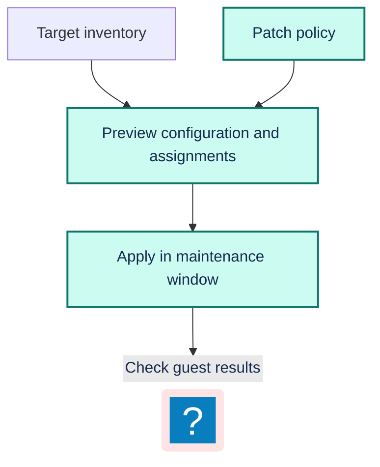

A patch schedule is only useful when the intended machines are assigned to it and the guest operating systems actually install their updates. The Acestus approach treats those as separate things to define, review, and verify.

This article describes a reusable design for Azure VM patch management. The examples use fictional configuration and describe an implementation pattern, rather than a claim that a particular environment has passed a patching audit.

## Separate policy from scope

A shared maintenance configuration defines the patch policy: classifications, reboot behavior, time zone, recurrence, and window duration. A reviewed inventory defines which VMs receive that policy. One explicit assignment connects each selected VM to the configuration.

That separation makes a scope change visible. Adding a VM should produce an inventory change and a corresponding assignment in the deployment preview. Creating the schedule alone does not establish coverage.

| Concern | Source of truth |
| --- | --- |
| Schedule and patch policy | Bicep maintenance configuration |
| Intended VM coverage | Reviewed target inventory |
| Deployment identity | Explicit subscription-to-identity mapping |
| Actual assignments and patch results | Azure resource and guest status |

Keep platform prerequisites in the VM's owning infrastructure stack. Assigning a maintenance window should not quietly change a shared VM template or the workload's patch mode.

## Make the repository explain the operation

A compact repository layout keeps the contracts easy to inspect:

```text
stacks/patch/
  main.bicep          # Shared InGuestPatch maintenance configuration
  assignment.bicep    # Assignment for one VM
  targets.json        # Explicit target inventory
  identities.json     # Approved deployment identity mapping
.github/workflows/
  patch-plan.yaml
  patch-deploy.yaml
```

Use stable logical subscription keys in the inventory. Resolve actual subscription and identity values from reviewed environment configuration. This fictional example illustrates the shape:

```json
{
  "targets": [
    {
      "subscriptionKey": "acestus-example-production",
      "resourceGroup": "rg-acestus-example",
      "virtualMachines": ["vm-acestus-example-a", "vm-acestus-example-b"]
    }
  ]
}
```

The resolver should reject duplicate targets, unknown subscription keys, missing identity mappings, empty names, and unmet prerequisites. An invalid row is a failed validation, not a reason to silently reduce the deployment scope.

Keep the identity map separate from the target list. An empty target set should not imply permission to discover and assign every VM in a subscription.

## Preview the complete change

Use two workflows with different responsibilities. Pull-request checks build the templates and validate the manifests without Azure credentials. An authorized plan workflow previews the central configuration and every VM assignment using the identities intended for deployment.

Review the first maintenance window as an explicit input. Keep it stable after deployment; do not generate a new start time on every run. If the intended first window has passed, the owner should review the next window before applying the change.

The deployment order is equally explicit:

1. Validate the selected targets and identity mappings.
2. Enter the protected deployment environment.
3. Deploy the shared maintenance configuration.
4. Create assignments only after that deployment succeeds.
5. Read back the configuration and every expected assignment.
6. Inspect guest patch assessments and installation results.

Use short-lived OIDC authentication and identities scoped to their deployment boundaries. Creating assignments requires the appropriate target permissions and visibility of the shared configuration. Missing permissions should produce an actionable failure, rather than an automatic expansion of access.

## Verify what happened inside the VM

A successful What-If run describes proposed control-plane changes. A successful deployment establishes that Azure accepted the resource changes. Neither establishes that the workload safely installed its patches.

Track the guest outcome separately: completed, failed, skipped, or not yet reported. Verify that the VM is available, its guest tooling can perform the operation, and the reboot policy fits the workload. Treat a missing result as uncertainty that needs investigation.

Recovery also needs an explicit boundary. Changing or removing a future assignment does not uninstall updates already applied inside a guest. Document rescheduling, exceptions, workload recovery, and the owner who makes those decisions.

## A reusable implementation prompt

Provide this prompt with sanitized templates, manifests, workflow definitions, and the repository README:

```text
Implement an explicit Azure VM patch-management pattern in this repository.
Read the architecture guide, patch README, templates, target inventory,
identity mappings, and workflow contracts before editing.

Define a version-controlled InGuestPatch maintenance configuration and one
assignment per reviewed VM. Validate targets and identity mappings; reject
duplicates, malformed entries, unknown keys, and unmet prerequisites.

Keep credential-free PR checks separate from authenticated planning.
Preview the configuration and every assignment. Deploy the configuration
before assignment jobs. Use OIDC and the approved identities.
Keep VM platform prerequisites in their owning stack.

Add focused offline checks for resolution and deployment ordering.
Document verification, scheduling, exceptions, and recovery. Preserve
unrelated changes. Use fictional Acestus examples only. Do not deploy.
Report changed files, checks performed, and unverified boundaries.
```

The useful outcome is an auditable chain from policy to target to assignment to guest result. Each step answers a different operational question, and each deserves its own evidence.

## Continue the series

- [Microsoft Fabric CI/CD](/articles/microsoft-fabric-cicd/)
- [Azure Functions Python CI/CD](/articles/azure-functions-python-cicd/)
- [AI Software Factory: Skills, .NET CLI, and Repository Context](/articles/ai-software-factory/)

## How patch policy reaches a verified VM


