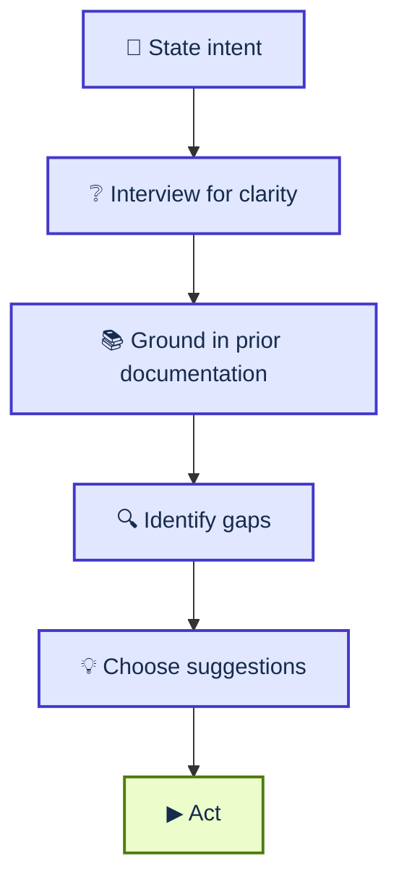

The most success I'm having with AI lately is using Claude Opus as a thinking partner, not just a generator.

1. I start with intent: I want to do this, and I want you to interview me until you're 95% confident. That forces the conversation out of guesswork and into clarity.
2. I point to prior documentation to manage context. If there's already a good source of truth, I want the model anchored to that instead of rebuilding the world from scratch.
3. Then I ask: What lack of clarity or blind spots are missing? That's where the real value shows up — assumptions, constraints, and gaps I hadn't named yet.
4. After that, I ask for suggestions for each gap, so the model turns uncertainty into action.
5. And then: Do it.

That workflow works because it treats AI like a partner for better thinking, not a shortcut for skipping it.

## From initial intent to an informed decision

