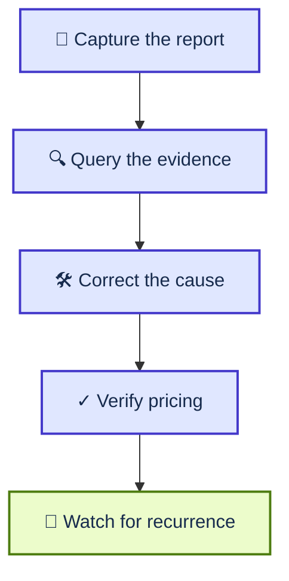

Pricing operations depends on careful investigation: understand a request, find the source of a discrepancy, select the right correction, and verify the outcome. That is the connection I see between my engineering background and a Pricing Operations Specialist opportunity at Microsoft.

My experience includes writing SQL scripts to resolve credit card variances, optimizing cloud billing and cost management, building analytical relational databases, and using queries to investigate operational events. Those are practical foundations for work where the numbers need to reconcile and the resolution needs evidence.

I hold a BS in Computer Science and a BA in History. That combination supports both sides of an investigation: analyzing the underlying data and explaining the evidence clearly to the people making a decision.

## Start with the individual request

An effective investigation begins by defining the discrepancy. Which record or result is disputed? What was expected? Which rule, time period, or source establishes that expectation?

My background spans help desk, cloud operations, and infrastructure engineering. It has required working from an individual problem toward a supported explanation, often across data, configuration, and service boundaries. For pricing operations, I would bring that same discipline to each request: establish scope before selecting a fix.

The important habit is to preserve the distinction between a reported symptom and a verified cause. A mismatch is the starting evidence; the explanation still needs to be established.

## Use queries to test the explanation

The closest direct connection in my experience is SQL work to resolve credit card variances. That work connects naturally to discrepancy investigation: compare records, isolate differences, and use the result to guide the correction.

I have also built analytical relational databases and written Kusto queries against operational data. Across those tools, the useful skill is asking a precise question of the available evidence and checking whether the result supports the proposed explanation.

For a fictional Acestus reconciliation exercise, I would investigate questions such as:

- Are the compared records from the same effective period?
- Do their identifiers, quantities, and units match?
- Is an apparent price difference actually a duplicate, missing record, or mapping issue?
- Does the exception affect one request or a recurring class of requests?

These are examples of how I would approach the work, rather than claims about Microsoft's internal pricing systems.

## Connect the correction to a business outcome

Cloud billing and cost management have given me experience working with financial consequences of technical choices. A correction should have a clear purpose and a defined scope. The person reviewing it should be able to understand what changes and why.

For a pricing request, I would document the affected records, the evidence for the cause, the proposed resolution, and any approval or ownership boundary. Where a business rule is unclear, I would resolve that ambiguity with its owner before treating an assumption as policy.

## Bring structure to pricing escalations

If the role includes deal-desk support, I would approach an escalation as a bounded investigation: identify the affected quote or transaction, establish the applicable approved pricing rule, and compare the expected result with the recorded result. I would distinguish a data discrepancy from an exception that requires a business decision.

That distinction matters when working with sales, finance, and program owners. Correcting a record and authorizing a pricing exception carry different responsibilities. My contribution would be to make the evidence, proposed action, and decision owner clear, then verify the approved outcome.

I would also look for recurring friction between a request, its supporting data, and the systems that process it. My experience writing automation and technical documentation provides a foundation for contributing to pricing-tool improvements: define the rule, identify the failure case, test the change, and document how operators verify it. These are transferable practices, not a claim of prior ownership of an enterprise deal desk.

## Verify the result and look for recurrence

My automation and CI/CD experience reinforces a useful operational habit: executing a change and proving its outcome are separate steps.

After a correction, I would repeat the relevant comparison, confirm the expected result, and check that the change did not affect unrelated records. The ticket should contain enough evidence for another person to understand the resolution without repeating the investigation from the beginning.

Recurring exceptions deserve a second question: can the process prevent this class of issue? A repeated mapping error might need validation at intake. Repeated missing information might need a clearer request form. Automation becomes useful once the rule and its exceptions are understood.

## What I bring to the opportunity

| Role requirement | Relevant experience |
| --- | --- |
| Investigate discrepancies | SQL scripts used to resolve credit card variances |
| Use data and tools | Relational databases, Kusto queries, Python, PowerShell, and C# |
| Understand financial impact | Cloud billing and cost management optimization |
| Verify outcomes | Infrastructure automation and CI/CD practices |
| Communicate findings | Technical documentation and stakeholder coordination |
| Support tool and process improvements | Automation scripting, analytical database work, and CI/CD practices |
| Technical academic foundation | BS in Computer Science |

My background is in engineering and operations. I would bring that experience to pricing work through careful query-based investigation, clear documentation, and verification that the requested outcome was achieved.

The specific pricing platform, reporting tools, and approval process would be part of learning the role. I would start with the established data definitions and operating procedures, then apply my SQL and scripting experience where they improve investigation and validation.

## Selected portfolio examples

These Acestus examples show how I approach analysis and operational work. They are demonstrations with illustrative data, not records of customer transactions or claims of experience with Microsoft's internal pricing processes.

| Example | Connection to pricing operations | Explore |
| --- | --- | --- |
| Pricing & Cost Optimizer | Compare modeled costs and see how configuration choices affect an estimate. | [Open demonstration](https://acestus.com/pricing.html) · [Read article](https://acestus.com/docs/pricing-optimizer/) |
| Log Pipeline | Follow events into a query layer and explore how queries support investigation and exception detection. | [Open demonstration](https://acestus.com/logs.html) · [Read article](https://acestus.com/docs/log-pipeline/) |
| Copilot-Ops Console | Explore ticket flow, investigation context, and the distinction between operator notes and requester updates. | [Open demonstration](https://acestus.com/copilotops.html) · [Read article](https://acestus.com/docs/copilot-ops-console/) |
| Workflow Toolkit | Explore how working records, review, and repeatable steps support consistent operational follow-through. | [Open demonstration](https://acestus.com/workflow.html) · [Read article](https://acestus.com/docs/workflow-toolkit/) |

For the engineering practices behind these examples, see [repeatable delivery](https://acestus.com/articles/azure-functions-python-cicd/) and [AI-assisted engineering workflows](https://acestus.com/articles/ai-software-factory/).

## Read my resume

For my full experience, technical skills, and education, [view my resume](https://acestus.com/resume/) or [download my resume as a PDF](https://acestus.com/downloads/william-weeks-balconi-resume.pdf).

## From a pricing discrepancy to a verified correction

