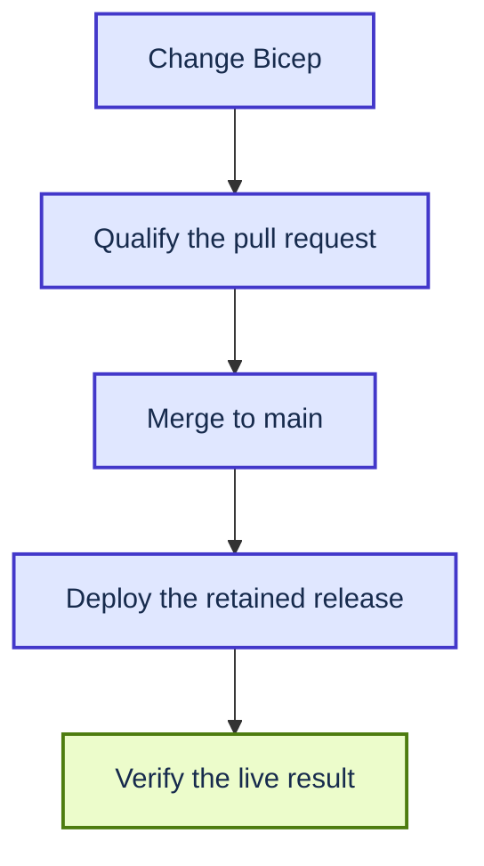

The infrastructure pipeline already uses Bicep and GitHub Actions. This guide summarizes the delivery path: validate a short-lived pull request, merge to main, then deploy the retained release through the configured environments with federated identity.

## Demo video



Watch the [7-minute end-to-end walkthrough](/videos/cicd-with-iac/) of the trunk pull request, automated checks, and deployment through development, staging, and production.

## Trunk workflow

~~~text
short-lived branch → pull-request validation → merge to main
  → build once → deploy and verify development → staging → production
~~~

Pull-request validation checks the proposed change without deploying it. The main-branch workflow builds the site once, retains the exact output, and promotes those same bytes through the release stages. Azure access uses GitHub's federated identity instead of a stored client secret.

The existing [Infrastructure as Code guide](/docs/iac-pipeline/) explains the Bicep, OIDC, and deployment design in more detail.

## Verify a site change

The release checks confirm this guide is present and the removed sample video is no longer available. You can verify the guide with curl:

~~~fish
curl -fsSL -H 'Cache-Control: no-cache' https://acestus.com/docs/bicep-github-actions-trunk/ | string match -q '*ACCEPTANCE-ID: BICEP-TRUNK-2026-11*'
~~~

The portfolio's post-deployment job checks the exact published guide and requires real 404 responses for the removed sample page and media.

## From Bicep pull request to verified delivery

