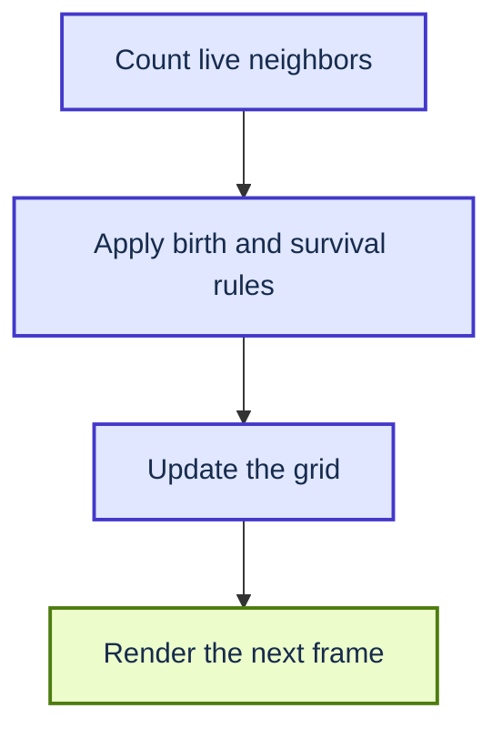

Conway's Game of Life on a **200×150 grid** (30,000 cells) running at 60fps. Color-coded by neighbor density. Seeded with a Gosper glider gun and R-pentomino for emergent complexity.


## The Rules


Each cell follows four simple rules:


1. **Underpopulation** — A live cell with fewer than 2 neighbors dies

2. **Survival** — A live cell with 2 or 3 neighbors lives

3. **Overpopulation** — A live cell with more than 3 neighbors dies

4. **Reproduction** — A dead cell with exactly 3 neighbors becomes alive


## Why WASM?


The inner loop iterates 30,000 cells, each checking 8 neighbors = 240,000 reads per generation. At 60 generations per second, that's 14.4 million cell reads per second. Rust's tight memory layout (a flat `Vec<bool>`) and LLVM optimization make this smooth even on mobile.


## Visual Design


Cells are colored by neighbor count to reveal density patterns:


- ■ Cyan — 0–1 neighbors (isolated/dying)

- ■ Green — 2 neighbors (stable)

- ■ Orange — 3 neighbors (reproductive)

- ■ Red — 4+ neighbors (overcrowded)


## Interaction


Click or tap any cell to toggle it alive/dead. Draw patterns and watch them evolve. The Gosper glider gun at the top-left continuously emits gliders that traverse the toroidal grid.


## Seeded Patterns


- **Gosper glider gun** — The first known finite pattern that grows indefinitely

- **R-pentomino** — A 5-cell pattern that takes 1,103 generations to stabilize

- **Random soup** — 25% density random fill for chaotic emergence


## Build


```text
wasm-pack build rust/life --target web --out-dir ../../resources/public/wasm/life
```

## One simulation tick in the Game of Life


