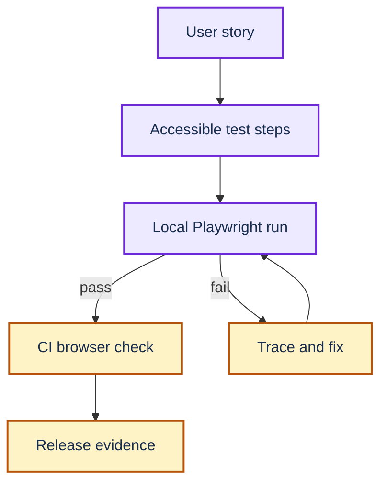

## Goal

Show an acceptance test that verifies an observable user outcome instead of only checking that a page loaded.

## Demonstration sequence

1. Choose a small workflow and identify the user-visible state change that counts as success.
2. Write a Playwright test using stable accessible locators and a deterministic fixture; run it locally while changing the behavior.
3. Run the same focused test in CI and inspect screenshots or traces when the expected outcome fails.

## Guardrails and evidence

Avoid brittle sleeps and live external services. Keep test data synthetic and make the acceptance condition explicit enough to fail meaningfully.

Finish with the evidence a viewer can reproduce: the source change, check output, and observable result. Keep the demonstration small enough to rebuild from a clean sample environment.

## Diagram

## Recording checklist

- State the question the example answers and identify the synthetic or disposable environment.
- Show the important configuration and one expected result before the walkthrough ends.
- Call out the operational limit that the green check does not cover.
