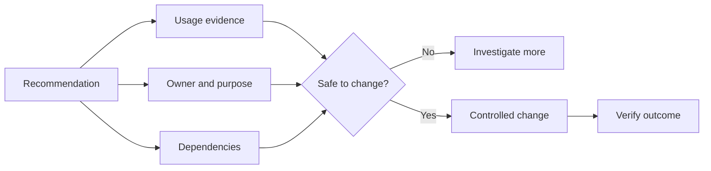

## Goal

Demonstrate why a recommendation is an investigation lead rather than automatic permission to delete a resource.

## Demonstration sequence

1. Use synthetic usage and cost values to explain the recommendation and its time window.
2. Check owner, recent utilization, dependencies, resilience needs, and a safe change plan before estimating savings.
3. Record a decision: act, gather evidence, or decline. Verify the result against a baseline after a controlled change.

## Guardrails and evidence

Use fictional cost data and resource names. Avoid implying savings without a time window, workload context, or a measured post-change comparison.

Finish with the evidence a viewer can reproduce: the source change, check output, and observable result. Keep the demonstration small enough to rebuild from a clean sample environment.

## Diagram

## Recording checklist

- State the question the example answers and identify the synthetic or disposable environment.
- Show the important configuration and one expected result before the walkthrough ends.
- Call out the operational limit that the green check does not cover.
