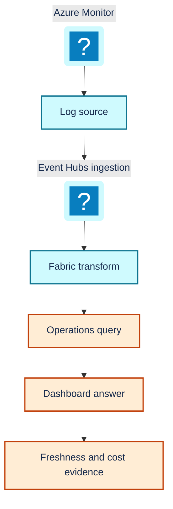

## Goal

Connect collection, ingestion, transformation, and query results while making the architecture and cost visible.

## Demonstration sequence

1. Generate a small synthetic operational event set and state the question it should answer.
2. Show the ingestion path, schema normalization, and one query or dashboard with an expected result.
3. List the services, retention choices, refresh cadence, and rough cost drivers that make the design operational.

## Guardrails and evidence

Use generated logs with no tenant, IP, user, or customer identifiers. Do not claim a dashboard provides alerting or freshness beyond what the pipeline proves.

Finish with the evidence a viewer can reproduce: the source change, check output, and observable result. Keep the demonstration small enough to rebuild from a clean sample environment.

## Diagram

## Recording checklist

- State the question the example answers and identify the synthetic or disposable environment.
- Show the important configuration and one expected result before the walkthrough ends.
- Call out the operational limit that the green check does not cover.
