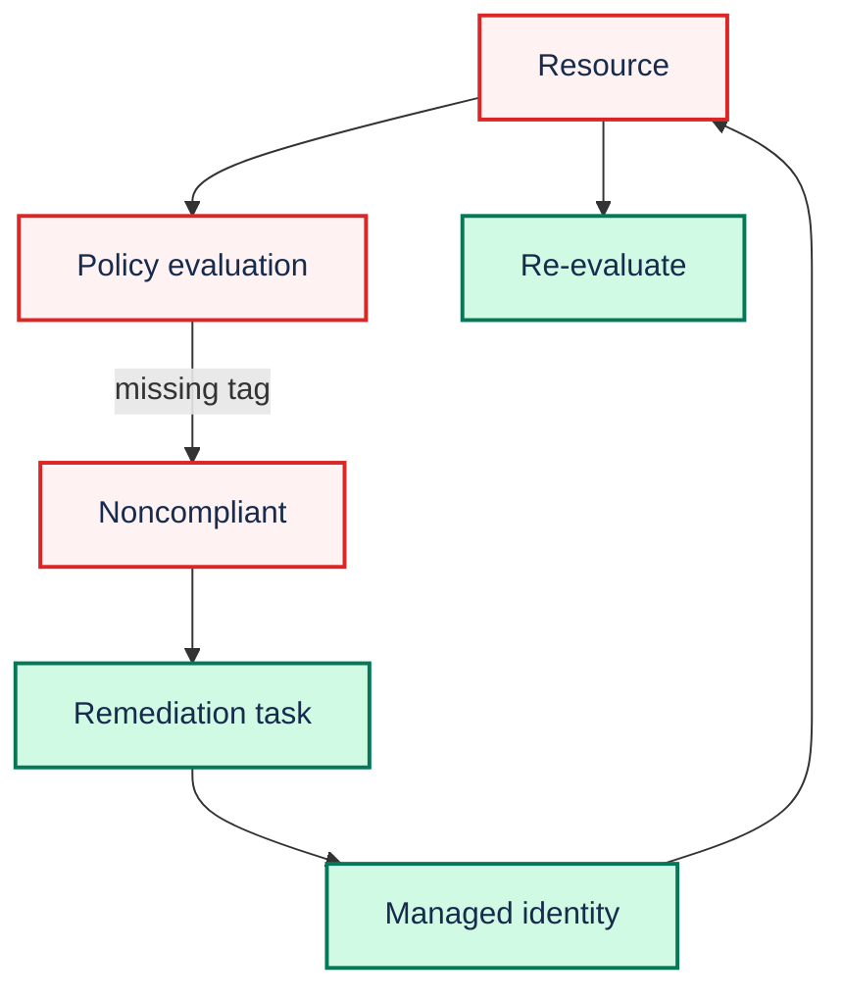

## Goal

Make the difference between compliance evaluation and an actual remediation task concrete.

## Demonstration sequence

1. Create a narrowly scoped policy assignment that audits one required tag on a sample resource group.
2. Create a harmless noncompliant test resource, inspect the compliance result, then start the managed remediation task.
3. Re-evaluate the resource and inspect identity permissions, task status, and the resulting tag.

## Guardrails and evidence

Run only in a disposable subscription and confirm the policy effect and remediation permissions. A compliant tag does not prove the tag value is accurate.

Finish with the evidence a viewer can reproduce: the source change, check output, and observable result. Keep the demonstration small enough to rebuild from a clean sample environment.

## Diagram

## Recording checklist

- State the question the example answers and identify the synthetic or disposable environment.
- Show the important configuration and one expected result before the walkthrough ends.
- Call out the operational limit that the green check does not cover.
