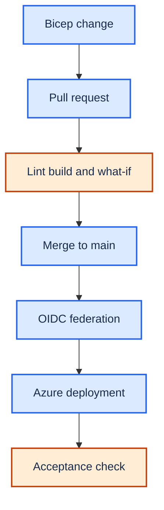

## Goal

Show how one reviewed Bicep change moves from validation to an authenticated deployment with useful evidence.

## Demonstration sequence

1. Make a small, safe resource change and run Bicep lint/build plus a what-if preview in the pull request.
2. Merge a short-lived branch through the trunk workflow and use GitHub OIDC to obtain Azure access without a stored password.
3. Check the deployed resource and the release run; explain rollback and the limits of the acceptance check.

## Guardrails and evidence

Use a disposable resource group and least-privilege identity. Never paste tokens, tenant data, or production subscription identifiers into the recording.

Finish with the evidence a viewer can reproduce: the source change, check output, and observable result. Keep the demonstration small enough to rebuild from a clean sample environment.

## Diagram

## Recording checklist

- State the question the example answers and identify the synthetic or disposable environment.
- Show the important configuration and one expected result before the walkthrough ends.
- Call out the operational limit that the green check does not cover.

## Demo video

[Watch the IaC deployment walkthrough](/videos/iac-deployment/).
