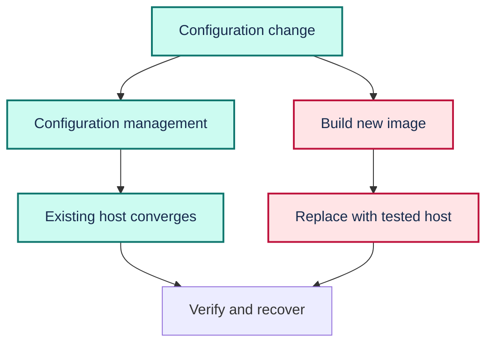

## Goal

Help teams reason about repeatability, recovery, and operational overhead for a routine configuration change.

## Demonstration sequence

1. Define one simple change, such as a package version or service setting, and write down the recovery goal.
2. Walk through a configuration-management run that converges a test server, then a rebuilt image deployment with the same change.
3. Compare auditability, time to recover, drift, rollout safety, and the owner's ongoing maintenance burden.

## Guardrails and evidence

Use disposable virtual machines and a harmless package or setting. Do not suggest either method guarantees security without a patch and verification process.

Finish with the evidence a viewer can reproduce: the source change, check output, and observable result. Keep the demonstration small enough to rebuild from a clean sample environment.

## Diagram

## Recording checklist

- State the question the example answers and identify the synthetic or disposable environment.
- Show the important configuration and one expected result before the walkthrough ends.
- Call out the operational limit that the green check does not cover.
