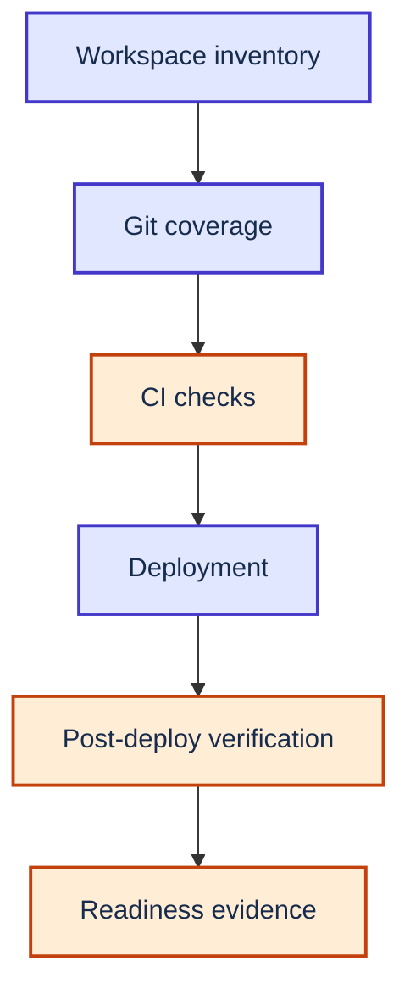

## Goal

Assess whether a Fabric workspace can be promoted safely and whether the team can prove what changed.

## Demonstration sequence

1. Inventory workspace items and source-control coverage; separate supported definitions from runtime data and permissions.
2. Trace one harmless definition change through validation and deployment. Review how schedules, connections, and secrets are managed after publication.
3. Record gaps as evidence-backed actions with an owner, impact, and a follow-up check.

## Guardrails and evidence

Use a disposable workspace and synthetic data. A green deployment says nothing about schedule health, runtime data correctness, or who can access the workspace.

Finish with the evidence a viewer can reproduce: the source change, check output, and observable result. Keep the demonstration small enough to rebuild from a clean sample environment.

## Diagram

## Recording checklist

- State the question the example answers and identify the synthetic or disposable environment.
- Show the important configuration and one expected result before the walkthrough ends.
- Call out the operational limit that the green check does not cover.
