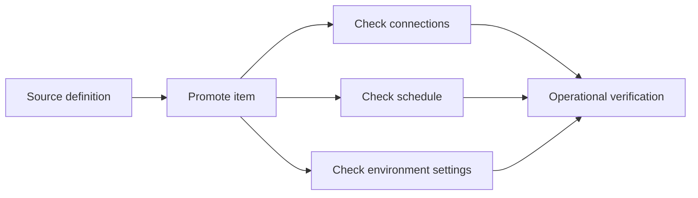

## Goal

Teach viewers to verify the operational settings around a published item, rather than stopping at a green deployment.

## Demonstration sequence

1. Choose one sample pipeline and list its schedule, connection, parameters, and environment-specific values before promotion.
2. Deploy the definition to a second workspace and inspect each setting; show which values are preserved, replaced, disabled, or require manual setup.
3. Use a post-deployment checklist and a deliberate missing-setting example to show how to detect an incomplete release.

## Guardrails and evidence

Platform behavior changes over time. Recheck the current item-type support matrix and never display tenant identifiers or real connection details.

Finish with the evidence a viewer can reproduce: the source change, check output, and observable result. Keep the demonstration small enough to rebuild from a clean sample environment.

## Diagram

## Recording checklist

- State the question the example answers and identify the synthetic or disposable environment.
- Show the important configuration and one expected result before the walkthrough ends.
- Call out the operational limit that the green check does not cover.
