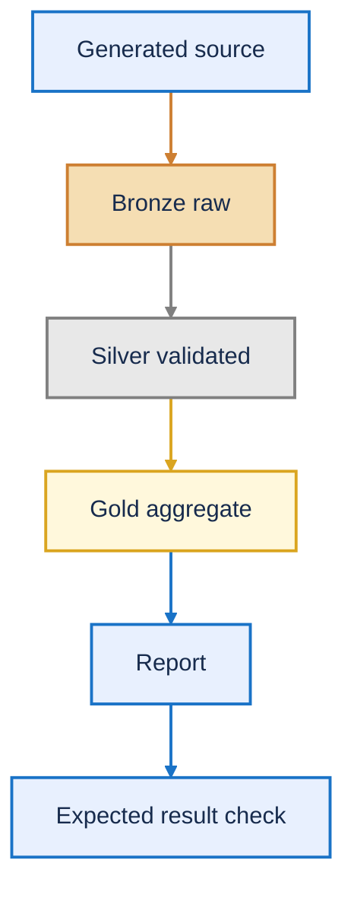

## Goal

Explain how a modest medallion pipeline turns raw input into a report that answers one explicit question.

## Demonstration sequence

1. Generate a compact synthetic source file and load it unchanged to Bronze with an ingestion timestamp.
2. Normalize types, reject or quarantine invalid rows in Silver, then aggregate one business question in Gold.
3. Check row counts, null handling, and a known expected result before presenting the report.

## Guardrails and evidence

Label generated data clearly. A successful pipeline run proves execution, not that transformations are analytically correct; retain a small expected-output check.

Finish with the evidence a viewer can reproduce: the source change, check output, and observable result. Keep the demonstration small enough to rebuild from a clean sample environment.

## Diagram

## Recording checklist

- State the question the example answers and identify the synthetic or disposable environment.
- Show the important configuration and one expected result before the walkthrough ends.
- Call out the operational limit that the green check does not cover.
