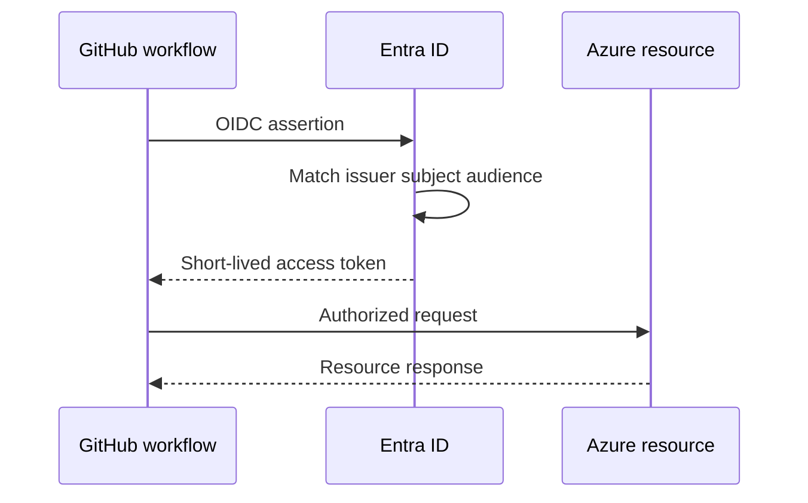

## Goal

Make the trust relationship from a repository workflow to an Azure identity understandable and testable.

## Demonstration sequence

1. Inspect the federated credential subject and audience configured on a demo identity.
2. Request a GitHub OIDC token in a protected workflow and exchange it through Azure login; avoid printing token material.
3. Query the active principal and demonstrate that a fork or untrusted branch cannot assume the deployment identity.

## Guardrails and evidence

Never echo tokens or use broad contributor permissions for convenience. Scope the identity and federated subject to the intended repository, branch, and environment.

Finish with the evidence a viewer can reproduce: the source change, check output, and observable result. Keep the demonstration small enough to rebuild from a clean sample environment.

## Diagram

## Recording checklist

- State the question the example answers and identify the synthetic or disposable environment.
- Show the important configuration and one expected result before the walkthrough ends.
- Call out the operational limit that the green check does not cover.
