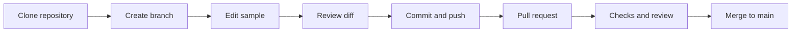

## Goal

Give a newcomer a safe, visual path from a local change to a reviewed infrastructure proposal.

## Demonstration sequence

1. Clone a sample repository, create a focused branch, and change a harmless tag or documentation value.
2. Inspect the changed files and diff in GitHub Desktop; commit with a message that describes intent.
3. Push the branch, open a pull request, read validation results, and return to the main branch after merge.

## Guardrails and evidence

Do not test deployments from an unreviewed branch or commit secrets. Explain that GitHub Desktop is a client for Git, not a replacement for review or CI.

Finish with the evidence a viewer can reproduce: the source change, check output, and observable result. Keep the demonstration small enough to rebuild from a clean sample environment.

## Diagram

## Recording checklist

- State the question the example answers and identify the synthetic or disposable environment.
- Show the important configuration and one expected result before the walkthrough ends.
- Call out the operational limit that the green check does not cover.
