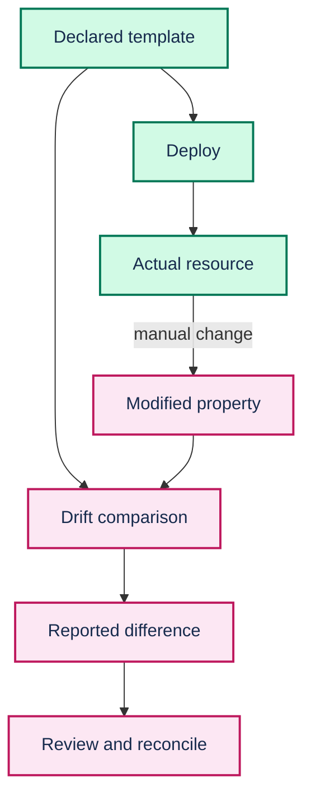

## Goal

Show drift as a useful difference signal that needs interpretation, not a complete measure of system health.

## Demonstration sequence

1. Deploy a small resource from a declared template and capture the expected configuration.
2. Change one harmless property outside the template, run the selected drift check, and inspect the reported difference.
3. Restore the declared value and list untracked runtime behavior, external dependencies, and data changes the check does not cover.

## Guardrails and evidence

Use a disposable resource group. A clean drift result means only that the selected comparison found no difference in its supported scope.

Finish with the evidence a viewer can reproduce: the source change, check output, and observable result. Keep the demonstration small enough to rebuild from a clean sample environment.

## Diagram

## Recording checklist

- State the question the example answers and identify the synthetic or disposable environment.
- Show the important configuration and one expected result before the walkthrough ends.
- Call out the operational limit that the green check does not cover.
