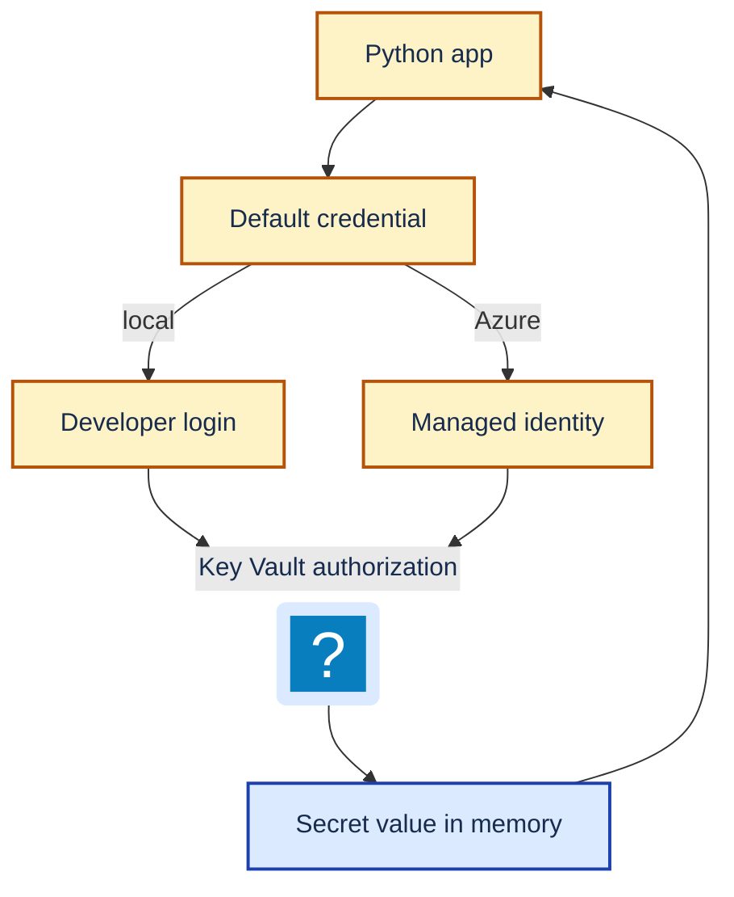

## Goal

Explain secret retrieval as an identity and authorization flow rather than a string copied into application configuration.

## Demonstration sequence

1. Create a sample Key Vault secret with a non-sensitive value and grant only the demo identity the necessary read permission.
2. Use the Azure SDK default credential chain in a Python example, distinguishing local developer login from deployed managed identity.
3. Verify success and denied access with safe output that never prints the secret itself.

## Guardrails and evidence

Never store real secrets in source, CI variables, screenshots, or terminal history. Restrict network reachability and rotate any credential used during setup.

Finish with the evidence a viewer can reproduce: the source change, check output, and observable result. Keep the demonstration small enough to rebuild from a clean sample environment.

## Diagram

## Recording checklist

- State the question the example answers and identify the synthetic or disposable environment.
- Show the important configuration and one expected result before the walkthrough ends.
- Call out the operational limit that the green check does not cover.
