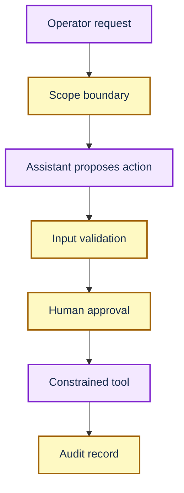

## Goal

Show how a narrowly scoped assistant can help with a repeatable operational task without receiving open-ended authority.

## Demonstration sequence

1. Choose a read-only or reversible task, define allowed inputs, and reject requests outside that scope.
2. Route the request through a typed tool with schema validation, least privilege, and a human approval point for changes.
3. Record the request, tool arguments, validation result, and outcome as an inspectable audit entry.

## Guardrails and evidence

Use mock resources and synthetic data. Treat model output as untrusted input; the tool, authorization layer, and operator decide what may happen.

Finish with the evidence a viewer can reproduce: the source change, check output, and observable result. Keep the demonstration small enough to rebuild from a clean sample environment.

## Diagram

## Recording checklist

- State the question the example answers and identify the synthetic or disposable environment.
- Show the important configuration and one expected result before the walkthrough ends.
- Call out the operational limit that the green check does not cover.
