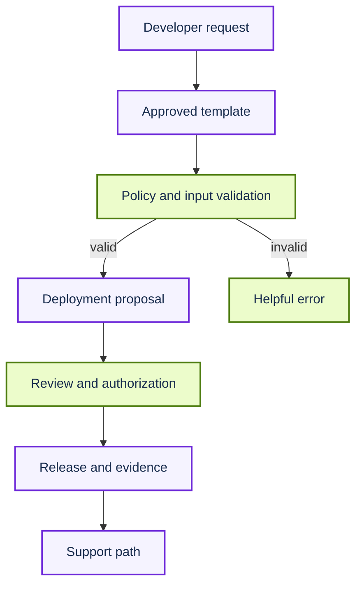

## Goal

Make the developer experience concrete: clear inputs, platform-owned defaults, useful errors, and traceable delivery.

## Demonstration sequence

1. Start with a small application request that declares only the details a service owner should choose.
2. Show a template or portal applying approved defaults, validating policy, and producing a pull request or deployment plan.
3. Follow the request through authorization, release evidence, and a support path when validation blocks it.

## Guardrails and evidence

Keep the demo honest about what is automated and who operates the platform. A template does not remove service ownership, access controls, or incident response.

Finish with the evidence a viewer can reproduce: the source change, check output, and observable result. Keep the demonstration small enough to rebuild from a clean sample environment.

## Diagram

## Recording checklist

- State the question the example answers and identify the synthetic or disposable environment.
- Show the important configuration and one expected result before the walkthrough ends.
- Call out the operational limit that the green check does not cover.
