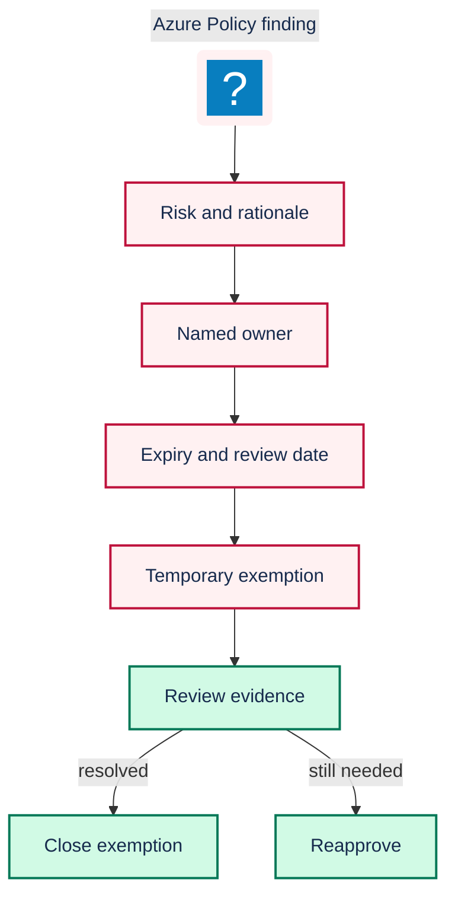

## Demo video

[Watch Azure Policy Scoping](/videos/azure-policy-scoping/) to see how the example records a resource scope, owner, and expiry date.



## Goal

Treat an exemption as a time-bounded governance record rather than a permanent way to silence a compliance finding.

## Demonstration sequence

1. Choose a fictional resource and state the policy, scope, reason, and compensating control.
2. Create an exemption with category, owner metadata, and an expiry date; inspect its effect on compliance reporting.
3. Review the exemption before expiry, then remove or renew it with current evidence and approval.

## Guardrails and evidence

Do not create permanent broad exemptions to make a dashboard green. The owner, scope, rationale, compensating control, and expiry should be searchable.

Finish with the evidence a viewer can reproduce: the source change, check output, and observable result. Keep the demonstration small enough to rebuild from a clean sample environment.

## Diagram

## Recording checklist

- State the question the example answers and identify the synthetic or disposable environment.
- Show the important configuration and one expected result before the walkthrough ends.
- Call out the operational limit that the green check does not cover.
