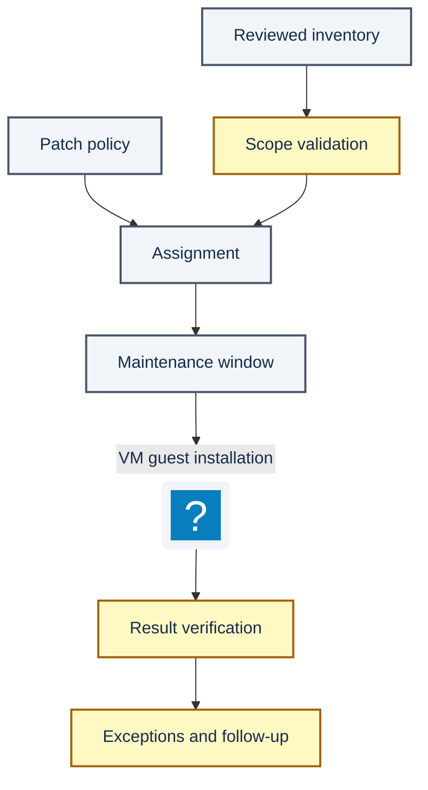

## Goal

Explain how an inventory, maintenance policy, assignment, and actual installation status work together.

## Demonstration sequence

1. Define a fictional target inventory, maintenance window, patch classifications, and reboot behavior.
2. Preview scope, handle a named exception with an expiry, and apply the schedule to one disposable VM.
3. Inspect guest patch status and maintenance results; show how failed or unreported machines remain visible.

## Guardrails and evidence

A schedule assignment is not proof that updates installed. Keep exception owners and review dates explicit, and do not patch production during a demo.

Finish with the evidence a viewer can reproduce: the source change, check output, and observable result. Keep the demonstration small enough to rebuild from a clean sample environment.

## Diagram

## Recording checklist

- State the question the example answers and identify the synthetic or disposable environment.
- Show the important configuration and one expected result before the walkthrough ends.
- Call out the operational limit that the green check does not cover.
