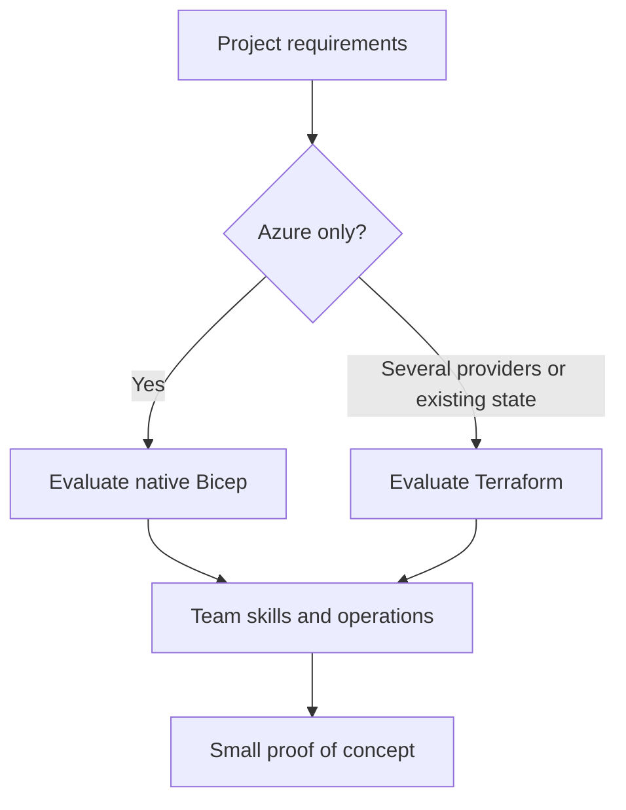

## Goal

Give a practical decision framework grounded in the team's cloud scope and operating model, not a universal winner.

## Demonstration sequence

1. Pick one small resource set and describe its lifecycle, collaborators, and target cloud before discussing syntax.
2. Compare plan/what-if review, state ownership, module reuse, validation, drift, and day-two operations using the same requirements.
3. Summarize which constraints favor each tool and identify a short experiment that could validate the choice.

## Guardrails and evidence

Keep examples equivalent and disclose version assumptions. Do not compare a mature module set in one tool against a toy example in the other.

Finish with the evidence a viewer can reproduce: the source change, check output, and observable result. Keep the demonstration small enough to rebuild from a clean sample environment.

## Diagram

## Recording checklist

- State the question the example answers and identify the synthetic or disposable environment.
- Show the important configuration and one expected result before the walkthrough ends.
- Call out the operational limit that the green check does not cover.
